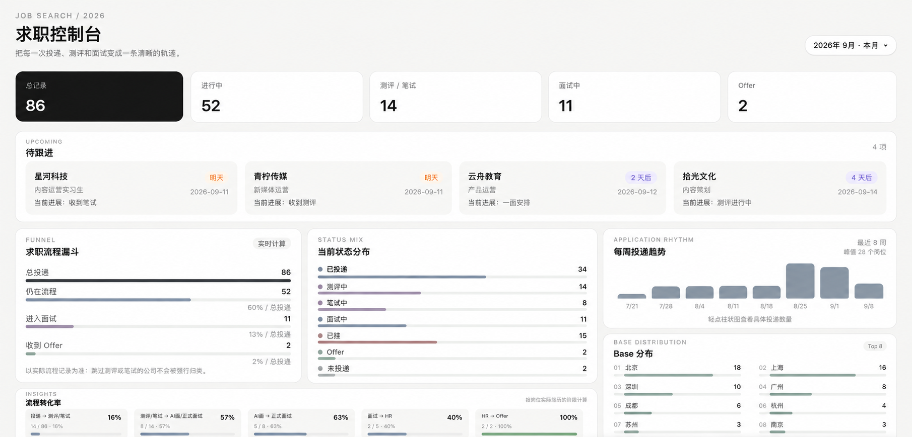
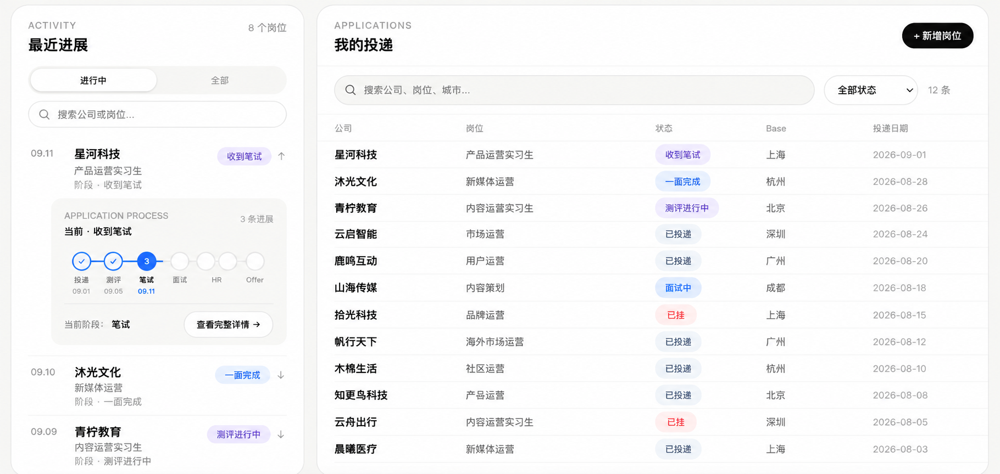

# Job Tracker

English | [简体中文](./README.zh-CN.md)

A private, single-user job-search dashboard built with Next.js and Notion. Track applications, progress events, dates, notes, links, and status changes in a focused local-style interface while keeping the source repository free of personal data.

This repository does not include any Notion credentials or personal job application data.
Each deployment uses the owner's own Notion integration and databases.

## 🖥️ Preview

### Dashboard and analytics



> ⚠️ Demo data notice: All company names, job titles, application statuses, dates, and statistics shown in these screenshots are fictional AI-generated demo data created solely to demonstrate the Job Tracker interface and features. They do not represent real job applications.

### Activity and applications



> The companies and roles shown above are also fictional AI-generated demo data.

## Features

- Create, edit, and delete job applications.
- Import a job screenshot with DeepSeek, review the prefilled fields, and confirm before saving.
- Record progress events and automatically sync the application status.
- View application details, a timeline, filters, pagination, and job-search insights.
- Store data in two connected Notion data sources that you control.
- Protect the dashboard and every API route with server-side HTTP Basic Authentication.

## Tech Stack

- Next.js 16, React 19, TypeScript
- Tailwind CSS 4
- Notion API (`@notionhq/client`)
- System font stack only; builds do not download Google Fonts

## Prerequisites

- Node.js 20 or later
- A Notion workspace where you can create integrations and data sources

## Install and run locally

```bash
git clone <your-fork-or-repository-url>
cd job-tracker
npm install
cp .env.example .env.local
```

Fill in `.env.local` with your own values, then start the app:

```bash
npm run dev
```

Open `http://localhost:3000`. The browser will request your `JOB_TRACKER_AUTH_USERNAME` and `JOB_TRACKER_AUTH_PASSWORD` before the dashboard or API routes are available.

## AI screenshot import (optional)

Set `DEEPSEEK_API_KEY` in your server environment or local `.env.local`, then restart the app. Configure the same variable in your hosting platform when deploying. Manual entry works without this key.

Choose **+ 新增岗位 → AI 截图识别**, upload one PNG, JPEG, or WebP image (up to 10MB), then start recognition. The server calls [`deepseek-flash`](https://api-docs.deepseek.com/guides/vision) and validates the returned JSON. Screenshots are used in memory for this request and are not saved by Job Tracker. They are sent to DeepSeek, so avoid screenshots containing sensitive information.

Review and edit the existing application form before confirming. Unknown fields stay empty, including the application date. If the status is unknown, select it manually before saving. Low-confidence fields show a light reminder. Recognition never creates a Notion record on its own.

The hosting platform must accept the upload request size; a lower platform request-body limit takes precedence over the app's 10MB limit.

Run `npm test`, `npx tsc --noEmit`, and `npm run build -- --webpack` to check this integration. Tests use generated images and mocked provider/Notion responses; they do not use real credentials or verify live recognition. `tests/ui-ai-test-server.mjs` provides a localhost-only mock proxy for checking the UI against a production app on port 3011 with the dummy login `test-user` / `test-password`.

## Notion Template (recommended)

Duplicate the ready-to-use database template into your own Notion workspace:

[Duplicate the Job Tracker Notion Template](https://rapid-acrylic-365.notion.site/Job-Tracker-Notion-Template-3d727236ee1381e9b4f2d98f2be1ebe0?source=copy_link)

The template contains no author's personal job-application data and no Notion token. Every user must create and use their own Notion integration.

1. Duplicate the Notion template into your own workspace.
2. Create your own Notion Integration.
3. Grant the integration access only to the two duplicated databases.
4. Copy the Applications and Progress Data Source IDs.
5. Copy `.env.example` to `.env.local`.
6. Fill in your own Notion token, data source IDs, and Basic Auth credentials.
7. Run `npm install` and `npm run dev`.

Do not commit `.env.local` to GitHub.

## Manual Setup and Database Schema Reference

Prefer the template above for a quick start. Use this section if you want to create the Notion data sources yourself or verify their required schema.

1. Create a Notion integration at [Notion integrations](https://www.notion.so/my-integrations) and copy its internal integration token into `NOTION_TOKEN`.
2. Create the **Applications** and **Progress** data sources described below with exactly the same property names and types.
3. Add a relation between the two data sources: `Progress.关联岗位` points to Applications, and the reciprocal Applications property is named `进度记录`.
4. Share both data sources with the integration from step 1.
5. Copy each data source ID into the matching variable in `.env.local`.
6. Choose a private Basic Auth username and a strong password for `JOB_TRACKER_AUTH_USERNAME` and `JOB_TRACKER_AUTH_PASSWORD`.

The project uses the following server-only environment variables:

```env
NOTION_TOKEN=your_notion_integration_token
NOTION_APPLICATIONS_DATA_SOURCE_ID=your_applications_data_source_id
NOTION_PROGRESS_DATA_SOURCE_ID=your_progress_data_source_id

JOB_TRACKER_AUTH_USERNAME=your_username
JOB_TRACKER_AUTH_PASSWORD=your_secure_password
```

## Required Notion data structure

Property names are part of the application contract. If a property name or type differs from the definitions below, the API may not work correctly.

### Applications data source

| Property | Notion type | Purpose |
| --- | --- | --- |
| `岗位标识` | Title | Display title for an application. |
| `公司名称` | Text | Company name. |
| `岗位名称` | Text | Role title. |
| `Base` | Text | Location or base. |
| `投递状态` | Status | Current application status. |
| `日期` | Date | Application date. |
| `备注` | Text | Private notes. |
| `官网链接` | URL | Job or company URL. |
| `JD` | Text / rich_text (optional) | Visible JD text extracted by AI; existing `职位描述`, `岗位描述`, or `Description` rich-text properties can also be reused. |
| `进度记录` | Relation | Reciprocal relation to Progress. |

Use these status options: `未投递`, `已投递`, `测评中`, `已测评`, `笔试中`, `已笔试`, `面试中`, `已挂`, and `收到offer`.

Screenshot import supports file selection, drag-and-drop, and Cmd+V / Ctrl+V image paste for PNG, JPEG, or WebP (up to 10MB). Recognition starts only after clicking the button. Unknown status/date remain null in the AI response, while the editable form defaults to “已投递” and the user's local date. JD publication/update dates are never treated as application dates. Only visible JD text is extracted, preserving line breaks; it stays editable. Normal text paste is unaffected.

Saving a nonempty JD checks the data source schema without changing it. If no supported rich-text property exists, saving stops with a message to add `JD` and retains the form; no application is created and JD is not silently discarded. Clearing JD allows saving through the original flow. Manual entry and the Progress API are unchanged.

### Progress data source

| Property | Notion type | Purpose |
| --- | --- | --- |
| `记录标题` | Title | Display title for a progress record. |
| `关联岗位` | Relation | Relation to one Applications record. |
| `公司名称` | Rollup | Roll up `公司名称` from `关联岗位`. |
| `岗位名称` | Rollup | Roll up `岗位名称` from `关联岗位`. |
| `Base` | Rollup | Roll up `Base` from `关联岗位`. |
| `事件类型` | Select | Event that occurred. |
| `阶段` | Select | Pipeline stage. |
| `事件日期` | Date | Date of the event. |
| `结果` | Select | Event result. |
| `下一步日期` | Date | Follow-up date. |
| `备注` | Text | Private notes. |
| `相关链接` | URL | Relevant URL. |

Use these select options:

- `事件类型`: `投递`, `收到测评`, `完成测评`, `收到笔试`, `完成笔试`, `收到AI面`, `完成AI面`, `收到一面`, `完成一面`, `收到二面`, `完成二面`, `收到三面`, `完成三面`, `收到HR面`, `完成HR面`, `收到Offer`, `淘汰`, `主动放弃`, `流程暂停`, `其他`.
- `阶段`: `投递`, `测评`, `笔试`, `AI面`, `面试`, `HR`, `Offer`.
- `结果`: `流程中`, `待定`, `通过`, `淘汰`, `主动放弃`, `Offer`, `流程终止`, `无结果`.

## Security notes

- Never commit `.env.local`; `.env.example` contains placeholders only and is safe to commit.
- Never use a `NEXT_PUBLIC_` prefix for the Notion token, data source IDs, or Basic Auth credentials. Such variables are bundled into browser code.
- Grant the Notion integration access only to the two target data sources.
- Deploy production instances over HTTPS. HTTP Basic Authentication must not be used over plain HTTP.
- Use a unique, strong `JOB_TRACKER_AUTH_PASSWORD` and rotate it if you suspect exposure.

## Deploy

Deploy to Vercel or any platform that supports Next.js.

1. Create a new project from your fork or repository.
2. Set all five environment variables from `.env.example` in the platform's server-side environment settings. Do not mark them as public variables.
3. Deploy with the standard build command:

   ```bash
   npm run build
   ```

4. Confirm the deployment is served through HTTPS, then open the site and authenticate with the Basic Auth credentials you configured.

For self-hosting, run `npm run build` followed by `npm run start` in an HTTPS-capable environment.
